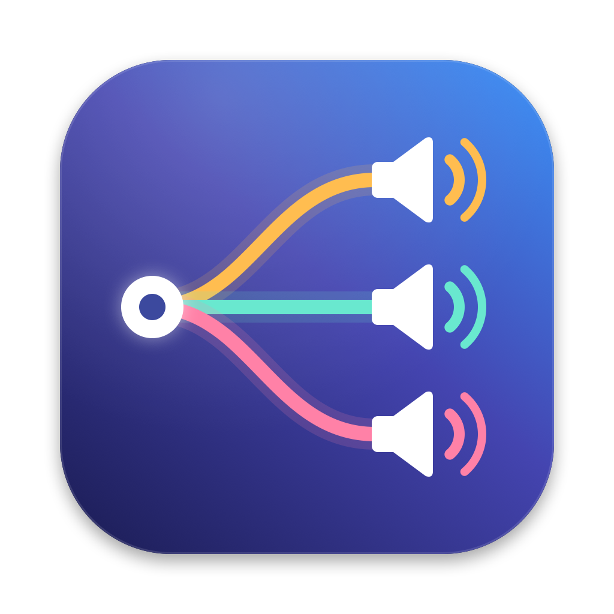

<p align="center"></p>

# SoundRouter

A macOS menu bar app that sends each app's sound, or even a single browser tab, to the speaker of your choice. YouTube can play on your Bluetooth speaker while everything else stays on the MacBook speakers.

## Features

- **Per-app speaker:** route any app to any connected output (built-in, Bluetooth, AirPlay, USB, HDMI). Apps you don't touch keep following the **Mac default** speaker.
- **Per-tab speaker:** with the companion browser extension, route individual Chrome, Brave or Edge tabs. A tab can go to a different speaker from the rest of the browser.
- **Volume everywhere:** a slider and mute for each speaker, each app and each routed tab. Speakers without a hardware volume (often HDMI) get a software volume.
- **Microphones:** choose the Mac's mic, set input levels and mute.
- **Keep headphones in high quality** (optional): if macOS switches the mic to Bluetooth headphones, which drops their playback to low-quality headset mode, SoundRouter switches it back to the Mac's mic.
- **Remembers your choices** per app, and re-applies them when the app or speaker comes back.
- **Menu bar first:** closing the window removes SoundRouter from the Dock; it keeps running in the menu bar.
- **Survives device changes:** speakers connecting or disconnecting, and sample-rate switches (for example Bluetooth headphones entering headset mode during a call).

## Requirements

- macOS 15 or later (developed and tested on macOS 27, Apple Silicon)
- Swift 6 toolchain: Xcode or just the Command Line Tools (`xcode-select --install`)
- For per-tab routing: a Chromium browser (Chrome, Brave, Edge). Safari and Firefox don't let extensions capture tab audio.

## Build and install

```sh
./build-app.sh
```

This builds a release binary, assembles `build/SoundRouter.app` (icon, Info.plist, bundled extension), signs it ad hoc and installs it to `~/Applications/SoundRouter.app`. Then open it:

```sh
open ~/Applications/SoundRouter.app
```

### Permissions

The first time an app is routed, macOS asks to allow **audio recording**. SoundRouter needs it to capture the sound an app plays so it can send it elsewhere; it never records a microphone. You can manage it under **System Settings › Privacy & Security › Screen & System Audio Recording**.

The app is signed ad hoc, so macOS may ask again after a rebuild.

## Browser extension (per-tab routing)

The extension lives in [`BrowserExtension/`](BrowserExtension). On every launch, the app also copies it to a stable location that it keeps up to date:

```
~/Library/Application Support/SoundRouter/BrowserExtension
```

To install it:

1. Open `chrome://extensions` and turn on **Developer mode**.
2. Click **Load unpacked**, press <kbd>⌘</kbd><kbd>⇧</kbd><kbd>G</kbd>, paste the path above and choose that folder.
3. In a tab, click the SoundRouter toolbar button (or press <kbd>⌥</kbd><kbd>⇧</kbd><kbd>S</kbd>) and pick a speaker.

Chrome only allows capturing a tab after you've clicked the extension once on that tab. After that, you can change the tab's speaker from the extension, the menu bar or the app window. After updating the extension's files, click the reload arrow on its card in `chrome://extensions`.

The extension needs the app running. If the app quits, captured tabs are released and play normally again.

## How it works

```
                        ┌────────────── SoundRouter.app ──────────────┐
 App (e.g. Spotify) ──► │ Core Audio process tap (app muted)           │
                        │   └─► private aggregate device ─► Speaker A  │
                        │                                              │
 Browser tab ─► ext ──► │ WebSocket 127.0.0.1:47390 ─► jitter buffer   │
   (tabCapture)         │   └─► IOProc on output device ─► Speaker B   │
                        └──────────────────────────────────────────────┘
```

- **Per-app routing** uses Core Audio *process taps* (`CATapDescription`, macOS 14.2+). For each routed app SoundRouter taps its processes, grouped by "responsible" app so that browser helpers belong to the browser. The tap mutes the app's normal output only while SoundRouter reads it, so audio comes back if SoundRouter quits. A private aggregate device pairs the tap with the target speaker, and an IOProc copies the audio across with gain applied.
- **Per-tab routing:** the extension captures the tab with `chrome.tabCapture` (which silences it in the browser), resamples it in an `AudioContext` to the speaker's sample rate, and streams 10 ms chunks of float PCM to the app over a local WebSocket. The app plays them through a lock-free ring buffer with a small jitter buffer (about 60 ms). Only `chrome-extension://` origins can connect, so web pages can't.
- **Sample-rate changes:** each tab player watches its speaker's nominal sample rate. When it changes, the app rebuilds the player and the extension re-renders the same captured stream at the new rate, with no extra click needed.

## Project layout

```
Sources/SoundRouter/
  SoundRouterApp.swift      App entry, menu bar item and popover, main window, Dock behaviour
  AudioModel.swift          State and logic: rules, routing, tabs, mics, headphone guard, colours
  TapRouter.swift           Per-app routing (process tap → aggregate device → speaker)
  TabPlayer.swift           Per-tab playback (ring buffer, jitter buffer, sample-rate watch)
  BrowserBridge.swift       Local WebSocket server for the extension
  Devices.swift             Speakers and microphones: listing, volume, mute, defaults
  Processes.swift           Which apps are using audio, grouped by responsible app
  CoreAudioHelpers.swift    Thin Core Audio property helpers
  MenuPanel.swift           Menu bar popover UI
  MainWindow.swift          Sidebar window UI (Apps & Tabs, Speakers, Microphones, Settings)
  Rows.swift, Theme.swift   Shared rows, chips, cards, colours
  ExtensionInstaller.swift  Copies the bundled extension to Application Support
  SelfTest.swift            Built-in test and screenshot modes (see below)
BrowserExtension/           Chrome MV3 extension (background, offscreen capture, worklet, popup)
Icon/                       make-icon.swift renders the icon; AppIcon.icns is used by the build
Tests/                      Integration tests (Node) and a sample-rate helper (Swift)
build-app.sh                Build, bundle, sign and install
```

## Testing

### Built-in test modes

Run against the installed app. Launch through `open` so that macOS attributes the audio permission to SoundRouter:

| Command | What it checks |
|---|---|
| `open -W -n ~/Applications/SoundRouter.app --args --selftest /tmp/self.log` | Devices, speaker volume, per-app routing (tap → speaker), app volume and mute, speaker sample-rate switches. Plays a short spoken clip. `SR_DEVICE=<name>` picks the target speaker. |
| `open -W -n --env SR_SIMULATE_BT_HEADSET="<mic name>" ~/Applications/SoundRouter.app --args --mictest /tmp/mic.log` | Mic listing and levels, and the "keep headphones in high quality" setting, using the named mic as a stand-in headset. |
| `…/SoundRouter --docktest /tmp/dock.log` | Closing the window hides the Dock icon; reopening from the menu bar restores it. |
| `…/SoundRouter --menutest <dir>` | Opens the real menu bar panel and main window and saves light and dark screenshots. `SR_SECTION=apps\|speakers\|microphones\|settings`, `SR_EXPAND=<row id>`, `SR_LONG=1`. |

Each mode writes a log ending in `ALL PASSED` or `N FAILURE(S)`, and restores any settings it changes.

### Integration tests (app must be running)

```sh
node Tests/bridge-test.mjs                    # simulated extension: routing, volume, errors, origin check

swiftc -O Tests/setrate.swift -o /tmp/setrate
SETRATE=/tmp/setrate node Tests/samplerate-test.mjs   # tab routing across speaker sample-rate changes

npm i puppeteer                               # real extension in Chrome for Testing
npx @puppeteer/browsers install chrome@stable
CHROME="<path to Chrome for Testing binary>" node Tests/extension-e2e.mjs
```

The sample-rate test switches the MacBook speakers between 48 kHz and 44.1 kHz and restores the original rate afterwards.

## Limitations

- Per-app *microphone* selection isn't supported. It would need a virtual audio driver. Call apps (Zoom, Meet, FaceTime) can pick their own mic.
- Per-tab routing adds about 60 ms of latency (whole-app routing adds none), and needs one click on the extension per tab.
- Tab routes aren't remembered across browser restarts. Tab IDs change.
- Bluetooth headphones drop to headset quality whenever any app uses their mic. That's a Bluetooth limitation; the "keep headphones in high quality" setting helps avoid it.

## Troubleshooting

- **"Couldn't route audio":** allow SoundRouter under Privacy & Security › Screen & System Audio Recording, then pick the speaker again.
- **Extension says "SoundRouter isn't running":** open the app. The extension reconnects within a couple of seconds.
- **Extension shows an error in `chrome://extensions`:** the folder it was loaded from probably moved. Remove it and load it again from `~/Library/Application Support/SoundRouter/BrowserExtension`.
- **Port 47390 already in use:** another copy of SoundRouter is running. Quit it from the menu bar (… › Quit SoundRouter).
